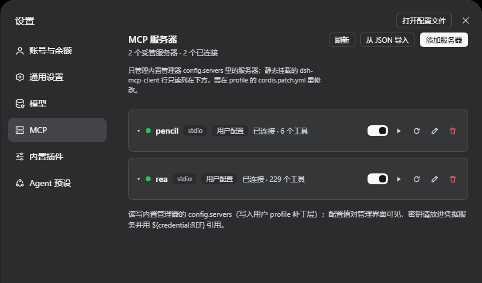

# dsh-mcp-ui

[](https://www.npmjs.com/package/dsh-mcp-ui)
[](./package.json)

在 **DeepSeek Harness** 的 Web 设置界面里管理 MCP 服务器：设置 → **MCP**。

> **为什么需要它**：Harness 内置的 `@deepseek-ai/dsh-mcp-manager` 已经提供了一整套运行时能力——`config.servers` 热增删、连接状态、`probe`、`restart`、凭据模板——但**没有界面**。本插件补上这一页，并且不另建配置存储：读写的就是内置管理器的配置。



## 快速开始

1. 安装（任选其一）：
   - npm：`dsh plugin --profile <profile> add dsh-mcp-ui`
   - 本地目录：`dsh plugin --profile <profile> add file:<本仓库绝对路径>`
   - 或在 **设置 → 插件 → 插件管理** 里用「添加插件」选择本目录
2. 重启 Harness，或刷新 Web 页面（bundle 层变更生效）
3. 打开 **设置 → MCP**

## 功能

| 能力 | 说明 |
|---|---|
| 列表与状态 | 每个服务器一张卡片：状态点、名称、传输方式、来源（用户配置 / 用户覆盖 / 继承 / 插件注册 / 待清理）与实时状态（已连接 · N 个工具 / 连接中 / 重连中 / 等待凭据 / 失败原因）|
| 启用 / 禁用 | 开关写入 `enabled`，管理器即时卸载或挂载实例，无需重启 Harness |
| 新增 / 编辑 | stdio（命令、参数、环境变量、工作目录）或 streamable-http（URL、请求头）；可选启动 / 工具调用 / 关闭超时与断线重连 |
| 从 JSON 导入 | 粘贴单个对象、对象数组或 `servers` 映射；一次原子写入，可勾选覆盖同名；「填入当前配置」可把现有服务器导出成同样格式 |
| 测试连接 | 调管理器 `probe`：解析凭据模板 → 连接 → 列出工具 → 关闭。**不触碰正在运行的实例**，返回服务端名称、工具清单、耗时与清理结果 |
| 重启 | 重建单个实例并重置重连预算 |
| 删除 | 用户层条目直接删除；覆盖条目删除后恢复基础配置 |
| 静态客户端（只读） | 单独列出通过 cordis 配置挂载的 `dsh-mcp-client` 行（不在管理器编队内），显示 Loader 阶段，避免"列表为空但其实有 MCP 工具"的误判 |

行内操作是四个图标按钮：**▶** 测试连接、**↻** 重启、**✎** 编辑、**🗑** 删除（悬停显示带服务器名的提示，读屏用同一文案）；探测期间 **▶** 变为旋转环；只读行显示锁图标。

## 从 JSON 导入

设置 → MCP → **从 JSON 导入**，三种形态都接受：

```jsonc
// 1) 单个服务器（name 从条目里取）
{"name":"pencil","transport":"stdio","command":"C:\\path\\mcp-server.exe","args":["--app","desktop"],"env":{}}

// 2) 数组
[{"name":"a","transport":"stdio","command":"npx"},{"name":"b","transport":"streamable-http","url":"https://mcp.example.com/mcp"}]

// 3) config.servers 映射（也可直接粘贴裸映射）
{"servers":{"a":{"transport":"stdio","command":"npx"}}}
```

- **原子写入**：任一条目不合法则整批不落盘（宿主用单次 `settings.mutate`）
- 默认拒绝同名；勾选「覆盖已存在的同名服务器」后覆盖
- 单次最多 50 条
- `env` / `headers` 的值支持 `${credential:REF}`，不要把明文密钥写进配置
- 名称规则：`[A-Za-z0-9_-]{1,32}`，即工具命名空间 `mcp__<name>__<tool>` 中的 `<name>`

## 受管服务器 vs 静态挂载客户端

| | 受管服务器（管理器 `config.servers`）| 静态挂载客户端（`dsh-mcp-client` 行）|
|---|---|---|
| 归属 | 管理器的配置条目，管理器为它挂载子实例 | 独立 Loader 插件行，有自己的 fiber |
| 配置位置 | 管理器的 `servers`（volatile，经 Settings/ConfigEditor 持久化）| 该行 `config`，写在 bundle 补丁、profile `cordis.patch.yml`、机器级补丁或 preset 组装里 |
| 本页能力 | 增删改、启停、probe、restart | 只读列出（名称、传输、Loader 阶段）|
| 生效方式 | 写入即 reconcile，无需重启 | 改组装后由 Loader 重载 |
| 名字 | 不能与静态实例的 `serverName` 重名 | 占住名字 |

> 静态行来自哪一层并不固定：出厂 bundle、profile 安装的 bundle、profile 补丁、机器级 `$DSH_HOME/cordis.patch.yml`、`--patch` 覆盖层，甚至 agent preset 的组装都可以插入它。页面读的是**当前进程实际挂载的 Loader 树**，因此无法告诉你某一行的来源文件。

## 配置与安全边界

- HTTP API 仅监听回环（`/api/mcp-manager`）：`GET /state` 与 `POST /action`（`probe` / `restart` / `enable` / `disable` / `add` / `save` / `delete` / `import`），写操作参数走白名单校验
- 写入走 Settings 表单服务（`settings.mutate` + revision 乐观锁），与设置界面同一条持久化路径；不手写、不重排 profile 的 `cordis.patch.yml`
- 配置值（`env` / `headers` / `command` / `url` 等）对本页可见——这是内置管理器与 Settings 通道的既有语义。**密钥请放进凭据服务**，在值里写 `${credential:REF}`
- 不注册任何模型可见的工具或提示词；页面只是管理面
- 客户端不引用任何 Harness Client 包，只用 `react` 与 `--dsw-alias-*` 主题 token

## 依赖与兼容性

- 已验证环境：DeepSeek Harness `0.2.2-rc.5`（Desktop / Web profile）
- 运行时依赖（Harness 自带，无需另行安装）：
  - `@deepseek-ai/dsh-mcp-manager` —— `config.servers`、运行时状态、`probe`、`restart`
  - `@deepseek-ai/dsh-settings` + `@deepseek-ai/dsh-config-editor` —— 读取与持久化
  - `@deepseek-ai/dsh-client-ui-settings` —— 声明 `settings.section` 槽位
- 缺任一服务时页面会给出明确提示，不会静默失败
- 本包**零 npm 运行时依赖、无构建步骤**

## 故障排查

| 现象 | 原因 | 处理 |
|---|---|---|
| 页面提示"未找到管理器配置命名空间" | 当前 profile 未挂载 `@deepseek-ai/dsh-mcp-manager` | 使用 Web/Desktop 默认 profile，或自行插入该行 |
| 保存返回 `409 / 写入配置失败` | 另一个窗口改过配置（revision 冲突） | 刷新后重试 |
| 条目 `failed`，错误含 `serverName "…" is already in use` | 与静态挂载或插件注册的实例重名 | 换一个 `name`，或移除冲突的静态行 |
| 页面看不到某个服务器，但工具存在 | 它是静态挂载或 preset 内的实例 | 见上文对照表；本页只读列出静态行，preset 内实例不列出 |
| 写入被拒绝并提到更高层覆盖 | 机器级 / bundle 补丁覆盖了该字段 | 改对应层，不要在用户层重复覆盖 |
| 修改后页面无变化 | 客户端模块已更新但页面未刷新 | 刷新页面（客户端改动无需重启 Harness） |

## 开发

```powershell
node tests/host.test.js           # 23 项：校验、合并、导入、HTTP 路由与错误码
node tests/client-module.test.js  # 13 项：真实模块加载、首屏渲染、草稿/合并/导入解析、图标按钮、按钮悬停
node --check client.js            # 客户端是纯 JS，无构建步骤
```

| 文件 | 作用 |
|---|---|
| `index.js` | 宿主入口：注册 `/api/mcp-manager` 路由 |
| `lib/host/api.js` | HTTP 处理与动作实现；错误带 `code` 供前端本地化；`import` 单次原子写入 |
| `lib/host/servers.js` | 条目校验、摘要、配置真相 × 运行时真相合并 |
| `lib/host/namespace.js` | 定位管理器的 Settings 命名空间 |
| `client.js` | 浏览器模块：注册 `settings.section`（id `mcp`）与导航图标 |

## 已知限制

- 只管理内置管理器辖下的服务器；preset 或静态行挂载的实例只读（静态行会列出，preset 内实例不列出）
- 插件 `mcpManager.register()` 的服务器只读
- 状态靠 2.5 秒轮询，不是服务端推送；对话框打开期间暂停轮询
- 探测结果中的工具名默认只显示前 20 个，其余折叠为「还有 N 个」
- 删除"继承"条目只移除用户层覆盖，不能删除基础层配置
- 首次写入后 profile 补丁会出现 `mcp-manager` 行的显式 `servers` 映射（Settings 通道的持久化方式，空映射与默认等价）
- 不支持 OAuth（继承内置管理器的限制）

## License

[MIT](./package.json)
